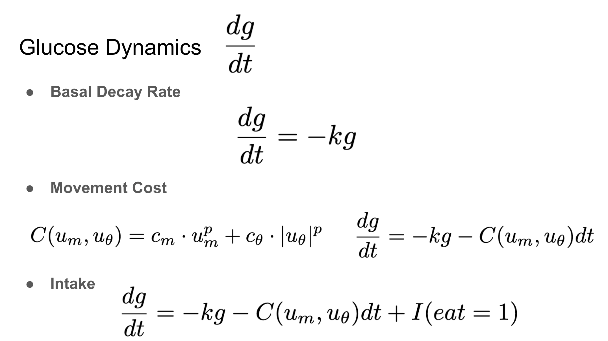

**Zebrafish Organ Model**

**Glucose Dynamics**
- base exponential decay, controlled by parameter GLUCOSE_HALF_LIFE
    - converted to an exponential decay rate by rate = ln 2 / half-life
- movement cost, controlled by parameters MOVE_COST_RATE and TURN_COST_RATE and MOVE_COST_EXPONENT
    - can modulate individual costs and shape of cost (exponent)
- intake, controlled by INTAKE_AMOUNT

